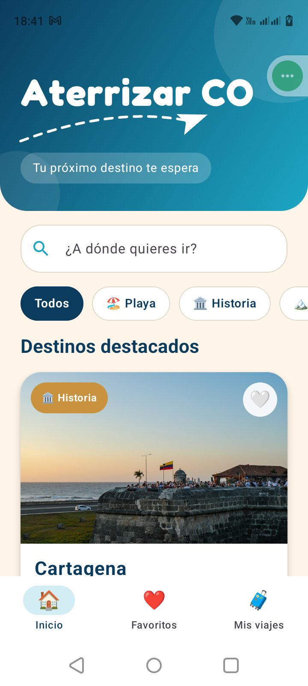
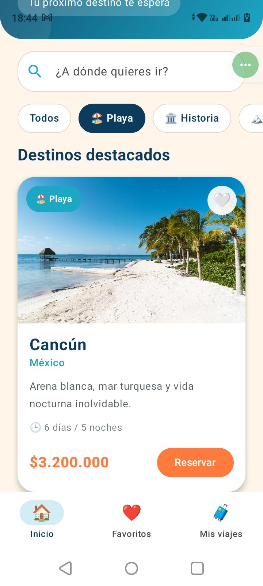
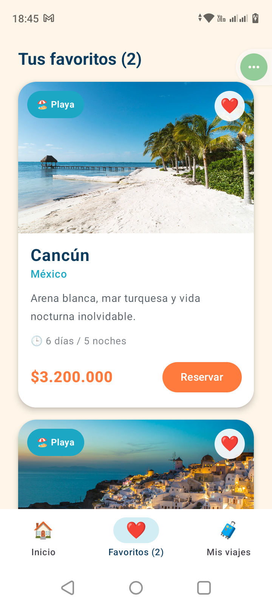
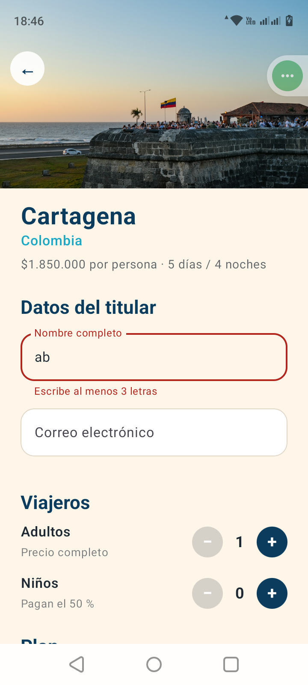
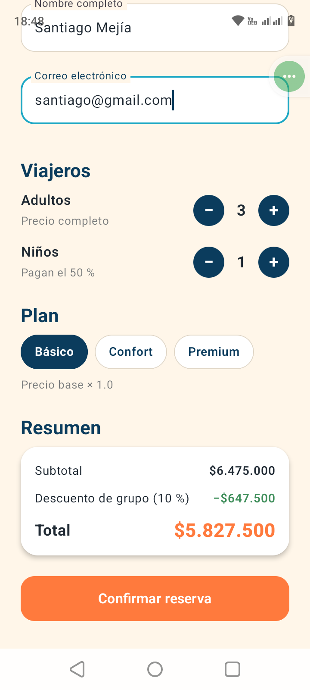
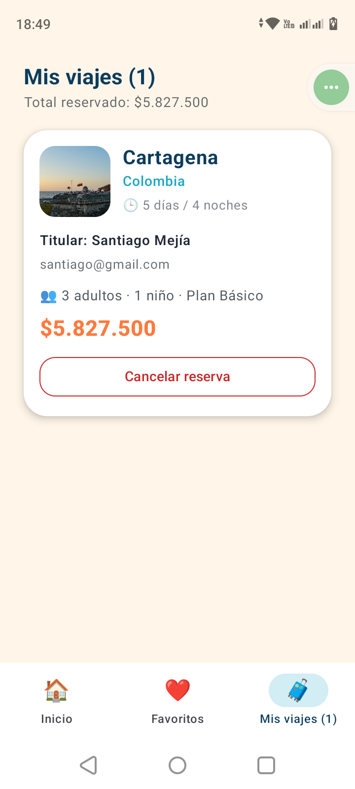

# ✈️ Aterrizar CO

App móvil de una agencia de viajes, hecha con **Kotlin** y **Jetpack Compose**.

- **Asignatura:** Desarrollo aplicaciones móviles
- **Autor:** Santiago Mejia

---

## 1. Nombre y descripción del negocio

**Aterrizar CO** es una agencia de viajes que ofrece paquetes turísticos a destinos nacionales e internacionales. Los destinos se organizan en cuatro categorías: playa, historia, montaña y ciudad.

Cada paquete muestra:

- La duración del viaje (días y noches).
- El precio por persona, en pesos colombianos.
- Una foto, una descripción corta y su categoría.

## 2. Objetivo de la aplicación

Que un cliente pueda, desde su celular:

1. Explorar y buscar destinos.
2. Guardar sus destinos favoritos.
3. Cotizar un viaje según el plan y el número de viajeros.
4. Confirmar la reserva y consultarla o cancelarla.

Esta es la primera versión de la app. Usa datos locales: no tiene base de datos, internet ni inicio de sesión.

## 3. Pantallas implementadas

La app tiene **4 pantallas** que se conectan con **Navigation Compose** (`NavController` y `NavHost`).

| Pantalla | Para qué sirve | Archivo |
|---|---|---|
| **Inicio** | Ver los destinos, buscarlos por nombre o país y filtrarlos por categoría | `InicioScreen.kt` |
| **Favoritos** | Ver los destinos marcados con el corazón | `FavoritosScreen.kt` |
| **Mis viajes** | Ver las reservas confirmadas y cancelarlas | `MisViajesScreen.kt` |
| **Reservar** | Llenar los datos del titular, elegir viajeros y plan, y ver el total | `ReservarScreen.kt` |

- Inicio, Favoritos y Mis viajes están en la **barra de navegación inferior**.
- **Reservar** se abre desde el botón *Reservar* de cualquier tarjeta. Recibe el destino elegido por medio de la ruta `reservar/{destinoId}`.

## 4. Funcionalidades

La app tiene **3 funcionalidades interactivas**:

| # | Funcionalidad | Origen |
|---|---|---|
| 1 | Búsqueda y filtrado de destinos | **Trabajada en clase** |
| 2 | Favoritos | **Nueva** |
| 3 | Reservar y cotizar | **Nueva** |

### Funcionalidad 1: Búsqueda y filtrado (trabajada en clase)

- Un campo de búsqueda filtra los destinos por **nombre o país**. No importan las mayúsculas ni las tildes: "paris" encuentra "París".
- Los chips de categoría (*Todos, Playa, Historia, Montaña, Ciudad*) filtran por tipo de destino. Se pueden combinar con la búsqueda.
- Si no hay resultados, la app muestra un mensaje.
- **Cómo funciona:** el texto y la categoría seleccionada son estados (`mutableStateOf`). Cada vez que cambian, se recalcula la lista con `filter`.
- **Archivos:** `InicioScreen.kt` y `Componentes.kt` (`Buscador`, `CategoriasRow`).

### Funcionalidad 2: Favoritos (nueva)

- Cada tarjeta tiene un corazón. Al tocarlo, el destino se marca o se desmarca (🤍 / ❤️).
- La pantalla **Favoritos** muestra solo los destinos marcados, o un mensaje si no hay ninguno.
- La barra inferior muestra cuántos favoritos hay, por ejemplo *Favoritos (2)*.
- **Cómo funciona:** el conjunto de ids de favoritos vive en `AterrizarApp` (estado compartido). Inicio y Favoritos lo reciben, y el corazón avisa con un evento (`onFavoritoClick`).
- **Archivos:** `MainActivity.kt`, `Componentes.kt` (`DestinoCard`), `FavoritosScreen.kt`.

### Funcionalidad 3: Reservar y cotizar (nueva)

Esta funcionalidad es distinta de Favoritos: tiene formulario con validaciones, cálculo de precios y crea y cancela reservas.

- **Formulario del titular:** nombre (mínimo 3 letras) y correo (formato válido). Los errores aparecen en el campo, y el botón *Confirmar reserva* se mantiene desactivado hasta que los datos sean correctos.
- **Viajeros:** adultos y niños con botones **+ / −**.
- **Plan:** Básico (×1.0), Confort (×1.25) o Premium (×1.5).
- **Reglas de precio:**
  - Cada niño paga el 50 %.
  - Desde 4 viajeros hay 10 % de descuento sobre el subtotal.
- **Resumen en vivo:** subtotal, descuento y total se recalculan con cada cambio.
  - Ejemplo: Cartagena, plan Premium, 2 adultos y 2 niños → subtotal $8.325.000, descuento −$832.500, **total $7.492.500**.
- **Mis viajes:** al confirmar, la reserva aparece con sus datos y el total. Se puede cancelar con un diálogo de confirmación. El encabezado muestra el total reservado.
- **Archivos:** `ReservarScreen.kt`, `MisViajesScreen.kt`, `Destino.kt` (`calcularCotizacion`), `MainActivity.kt`.

## 5. Capturas de pantalla

| Inicio | Búsqueda y filtro | Favoritos |
|:---:|:---:|:---:|
|  |  |  |

| Reservar (formulario) | Reservar (resumen con descuento) | Mis viajes |
|:---:|:---:|:---:|
|  |  |  |

## 6. Cómo ejecutar el proyecto

**Requisitos**

- Android Studio reciente (el proyecto usa Android Gradle Plugin 9.4.1).
- Android SDK 37 instalado (se instala desde *SDK Manager*).
- Un emulador o un celular con Android 7.0 (API 24) o superior.
- Internet solo la primera vez, para que Gradle descargue las dependencias.

**Pasos**

1. Clona el repositorio:
   ```
   git clone https://github.com/Helly1903/Aterrizar-App
   ```
2. Abre Android Studio y elige **File → Open**. Selecciona la carpeta del proyecto.
3. Espera a que termine el **Gradle Sync** (barra de progreso abajo).
4. Elige un emulador o conecta tu celular con la depuración USB activada.
5. Presiona el botón verde **▶ Run 'app'**.


## 7. Estructura del proyecto

```
app/src/main/java/com/example/aterrizar_app/
├── MainActivity.kt          Punto de entrada, estado compartido y NavHost
├── Destino.kt               Modelos de datos, lista de destinos y cálculo de la cotización
└── ui/
    ├── components/
    │   ├── Header.kt        Encabezado con logo y avión dibujado en Canvas
    │   ├── Componentes.kt   Buscador, chips de categoría y tarjeta de destino
    │   └── EstadoVacio.kt   Mensaje para pantallas sin contenido
    ├── navigation/
    │   └── Rutas.kt         Nombres de las rutas y elementos de la barra inferior
    ├── screens/
    │   ├── InicioScreen.kt
    │   ├── FavoritosScreen.kt
    │   ├── MisViajesScreen.kt
    │   └── ReservarScreen.kt
    └── theme/
        ├── Color.kt         Paleta de colores de la marca
        ├── Theme.kt         Tema Material 3
        └── Type.kt          Tipografía
```

## 8. Conceptos de Jetpack Compose aplicados

| Concepto | Dónde se usa |
|---|---|
| `Column`, `Row`, `Box` | Todas las pantallas. `Box` pone el badge y el corazón sobre la foto |
| `LazyColumn` | Listas de Inicio, Favoritos y Mis viajes |
| `LazyRow` | Chips de categoría |
| Data class y colección | `Destino` y la lista `destinos` (8 elementos) |
| Composables reutilizables | `DestinoCard`, `CategoriaChip`, `EstadoVacio`, `ReservaCard` |
| Estado y eventos | `remember` + `mutableStateOf`, con eventos que suben por lambdas |
| Navigation Compose | `NavController`, `NavHost`, `composable`, ruta con argumento |
| Material 3 | `Scaffold`, `NavigationBar`, `Card`, `Button`, `OutlinedTextField`, `AlertDialog` |

## 9. Alcance de esta versión

Según el alcance del primer corte, la app **no incluye** base de datos, conexión a API, autenticación, persistencia de información, MVVM ni ViewModel.

Por eso, al cerrar la app o girar la pantalla, los favoritos y las reservas se reinician.
