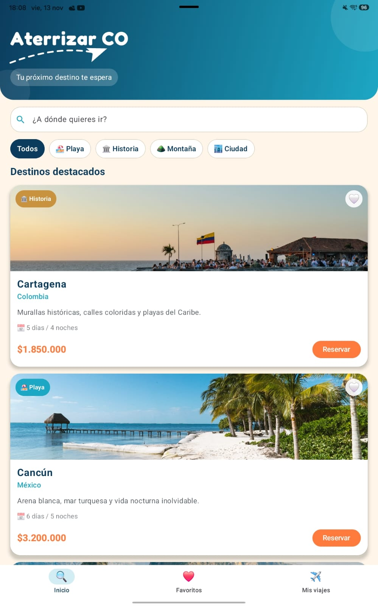
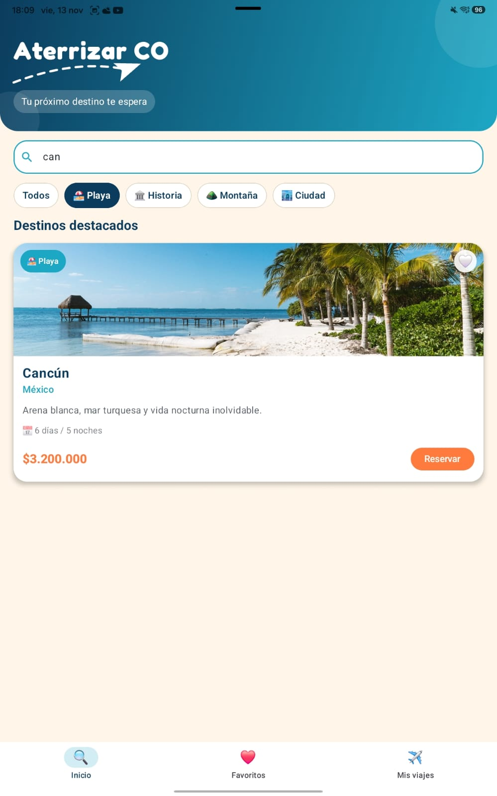
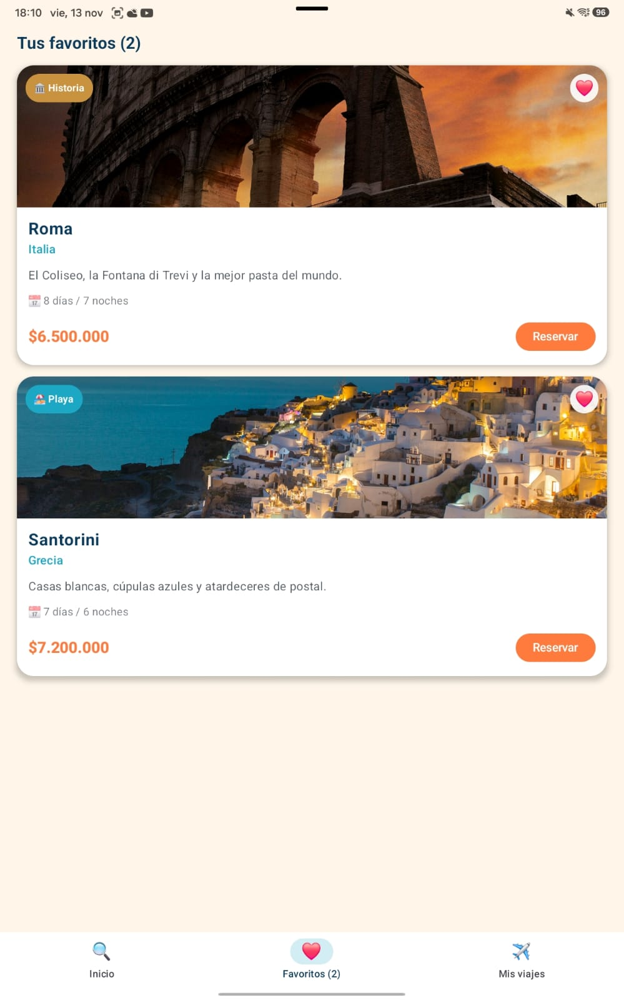
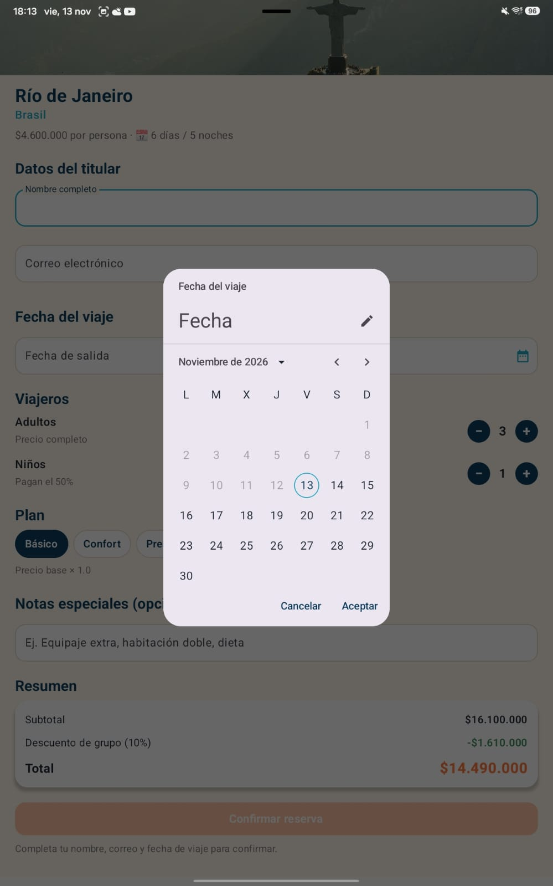
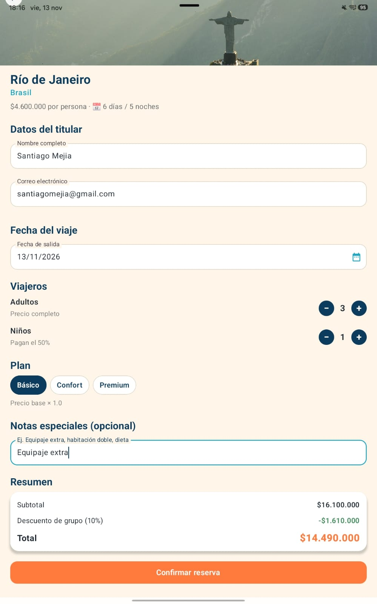
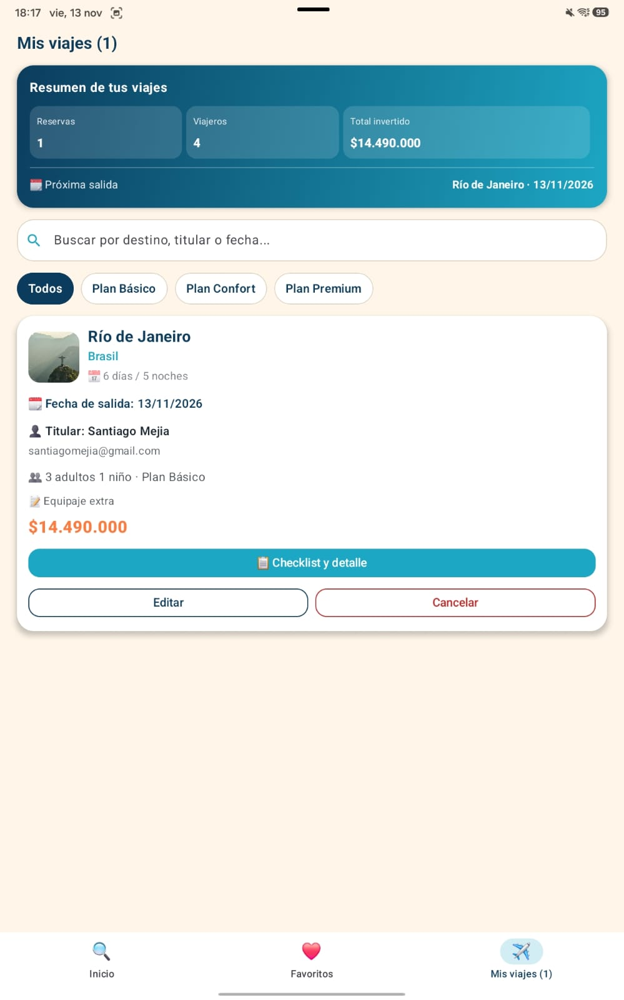
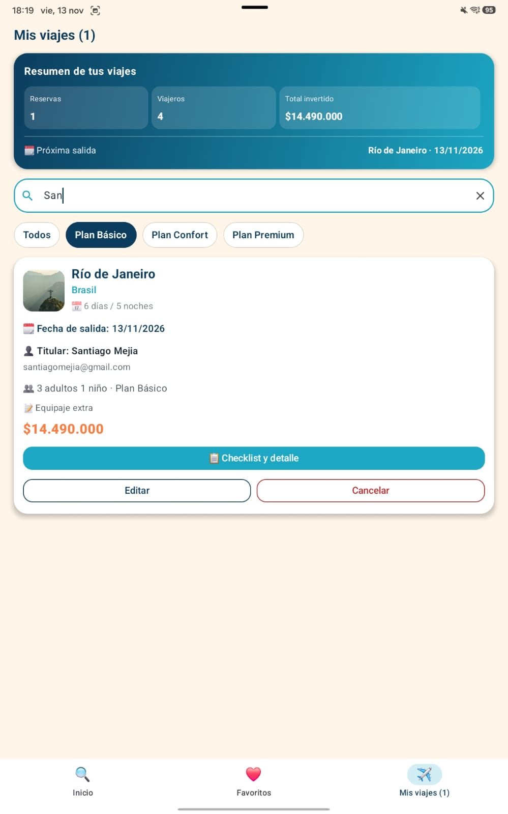
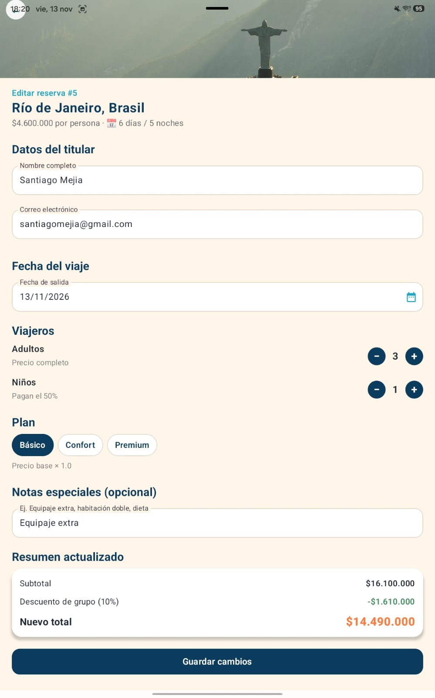
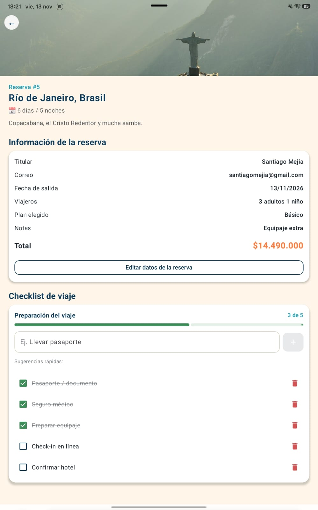

# ✈️ Aterrizar CO

App móvil de una agencia de viajes, hecha con **Kotlin**, **Jetpack Compose**, **MVVM** y **Room (SQLite)**.

- **Asignatura:** Desarrollo aplicaciones móviles
- **Autor:** Santiago Mejia

---

## 1. Nombre y descripción del negocio

**Aterrizar CO** es una agencia de viajes que ofrece paquetes turísticos a destinos nacionales e internacionales. Los destinos se organizan en cuatro categorías: playa, historia, montaña y ciudad.

Cada paquete muestra:

- La duración del viaje (días y noches).
- El precio por persona, en pesos colombianos.
- Una foto, una descripción corta y su categoría.

## 2. Objetivo de la aplicación

Que un cliente pueda, desde su celular:

1. Explorar, buscar y filtrar destinos por categoría.
2. Guardar sus destinos favoritos de forma persistente en base de datos local.
3. Cotizar un viaje según la fecha de salida, el plan, el número de viajeros y notas especiales.
4. Confirmar, consultar, filtrar, editar y cancelar reservas (CRUD completo).
5. Gestionar un **checklist interactivo** de preparación para cada viaje reservado.

Esta versión implementa arquitectura **MVVM** con **Room (SQLite)** y **Kotlin Coroutines / Flow**, por lo que los favoritos, las reservas y las tareas del checklist se conservan al cerrar la app o rotar la pantalla.

## 3. Pantallas implementadas

La app cuenta con **6 pantallas** conectadas mediante **Navigation Compose** (`NavController` y `NavHost`), ocultando la barra inferior en las vistas de detalle y formularios:

| Pantalla | Para qué sirve | Archivo |
|---|---|---|
| **Inicio** | Explorar los destinos, buscarlos sin tildes por nombre o país y filtrarlos por categoría | `InicioScreen.kt` |
| **Favoritos** | Ver y gestionar los destinos guardados con el corazón | `FavoritosScreen.kt` |
| **Mis viajes** | Ver estadísticas globales, buscar/filtrar reservas por plan, editarlas o cancelarlas | `MisViajesScreen.kt` |
| **Reservar** | Ingresar datos del titular, elegir fecha en calendario, viajeros, plan, notas y cotizar | `ReservarScreen.kt` |
| **Editar reserva** | Modificar cualquier dato de una reserva existente y recalcular su cotización | `EditarReservaScreen.kt` |
| **Detalle del viaje** | Consultar toda la información de la reserva y gestionar su checklist de viaje | `DetalleViajeScreen.kt` |

- **Inicio**, **Favoritos** y **Mis viajes** forman la **barra de navegación inferior** con contadores dinámicos.
- **Reservar** (`reservar/{destinoId}`), **Editar reserva** (`editar_reserva/{reservaId}`) y **Detalle del viaje** (`detalle_viaje/{reservaId}`) reciben argumentos tipados por ruta.

## 4. Funcionalidades

| # | Funcionalidad | Descripción |
|---|---|---|
| 1 | **Búsqueda y filtrado de destinos** | Búsqueda insensible a mayúsculas y tildes (`sinTildes()`) combinable con chips de categoría (*Todos, Playa, Historia, Montaña, Ciudad*). |
| 2 | **Favoritos persistentes (Room)** | Marcado/desmarcado desde cualquier tarjeta (`🤍` / `❤️`) almacenado en la tabla `favoritos` de SQLite. |
| 3 | **Cotizador y creación de reservas** | Validación de titular y correo, selector de fecha (`DatePickerDialog` bloqueando fechas pasadas), adultos/niños, planes (*Básico ×1.0, Confort ×1.25, Premium ×1.5*), notas opcionales y cálculo en vivo. |
| 4 | **Gestión y edición de reservas (CRUD)** | Tarjeta resumen con total de reservas, viajeros, inversión acumulada y próxima salida; búsqueda y filtro por plan; edición completa y cancelación con diálogo de confirmación. |
| 5 | **Checklist por viaje (Entidad relacionada)** | Lista de tareas vinculada por llave foránea (`CASCADE`) a cada reserva, con barra de progreso, sugerencias rápidas en chips, creación, marcado y eliminación. |

### Reglas de cotización (`Cotizador.kt`)

- Cada adulto paga el **100 %** y cada niño el **50 %**.
- El plan elegido multiplica el valor base: **Básico (×1.0)**, **Confort (×1.25)** o **Premium (×1.5)**.
- Desde **4 viajeros** en total se aplica automáticamente un **10 % de descuento** sobre el subtotal.

## 5. Capturas de pantalla

| Inicio | Búsqueda y filtro | Favoritos |
|:---:|:---:|:---:|
|  |  |  |

| Reservar (datos y fecha) | Reservar (notas y resumen) | Mis viajes y estadísticas |
|:---:|:---:|:---:|
|  |  |  |

| Filtros en Mis viajes | Editar reserva | Detalle y checklist |
|:---:|:---:|:---:|
|  |  |  |

## 6. Cómo ejecutar el proyecto

**Requisitos**

- Android Studio reciente (Android Gradle Plugin **9.4.1**, Kotlin **2.0.21**, KSP).
- Android SDK **37** instalado desde *SDK Manager* (`minSdk = 24`, `targetSdk = 36`).
- Un emulador o dispositivo físico con Android 7.0 (API 24) o superior.
- Conexión a internet la primera vez para descargar dependencias de Gradle.

**Pasos**

1. Clona el repositorio:
   ```bash
   git clone https://github.com/Helly1903/Aterrizar-App.git
   ```
2. Abre Android Studio, selecciona **File → Open** y elige la carpeta del proyecto.
3. Espera a que finalice la sincronización de **Gradle**.
4. Selecciona un emulador o conecta tu dispositivo con depuración USB activada.
5. Presiona **▶ Run 'app'**.

## 7. Estructura del proyecto

```text
Aterrizar-App-master/
├── capturas/                                    Capturas de pantalla usadas en el README
└── app/
    ├── EstadoReserva.kt                         Enum con estados visuales de reserva
    └── src/main/java/com/example/aterrizar_app/
        ├── MainActivity.kt                      Punto de entrada, instancia Database, Repository y ViewModel
        ├── Util/
        │   ├── Cotizador.kt                     Lógica de cálculo de subtotal, descuento y total
        │   └── Formato.kt                       Formato de moneda COP, normalización sin tildes y texto de viajeros
        ├── data/
        │   ├── DestinosData.kt                  Catálogo inicial de 8 destinos turísticos
        │   └── local/
        │       ├── AterrizarDao.kt              Consultas y operaciones CRUD con Flow y suspend
        │       ├── AterrizarDatabase.kt         Base de datos Room (aterrizar_database, versión 3)
        │       ├── ChecklistItemEntity.kt       Entidad Room de tareas con ForeignKey a ReservaEntity
        │       ├── FavoritoEntity.kt            Entidad Room para destinos favoritos
        │       ├── ReservaEntity.kt             Entidad Room para reservas confirmadas
        │       └── repository/
        │           └── AterrizarRepository.kt   Repositorio que mapea entidades Room a modelos de dominio
        ├── model/
        │   ├── Categoria.kt                     Enum de categorías con etiqueta y color
        │   ├── ChecklistItem.kt                 Modelo de dominio para ítems del checklist
        │   ├── Cotizacion.kt                    Modelo con subtotal, descuento y total
        │   ├── Destino.kt                       Modelo de paquete turístico
        │   ├── Plan.kt                          Enum de planes (Básico, Confort, Premium)
        │   └── Reserva.kt                       Modelo de dominio de reserva confirmada
        └── ui/
            ├── AterrizarApp.kt                  Scaffold raíz, estado reactivo y control de barra inferior
            ├── components/
            │   ├── Buscador.kt                  Campo de búsqueda estilizado
            │   ├── CamposTexto.kt               Colores compartidos para OutlinedTextField
            │   ├── CategoriaChip.kt             Chips seleccionables y fila horizontal de categorías
            │   ├── ContadorViajeros.kt          Selector numérico con botones + y −
            │   ├── DestinoCard.kt               Tarjeta de destino con imagen, badge y botón de favorito
            │   ├── EstadisticasViajesCard.kt    Tarjeta resumen con métricas y próxima fecha de salida
            │   ├── EstadoVacio.kt               Vista informativa para listas vacías
            │   ├── FilaResumen.kt               Fila clave-valor para desgloses de cotización y detalle
            │   ├── Header.kt                    Encabezado con degradado, fuente Fredoka y avión en Canvas
            │   ├── ReservarCard.kt              Tarjeta de reserva con acciones de checklist, editar y cancelar
            │   ├── SelectorFechaViaje.kt        Campo de fecha integrado con DatePickerDialog de Material 3
            │   └── TituloSeccion.kt             Encabezado tipográfico de sección
            ├── navigation/
            │   ├── AterrizarNavHost.kt          Grafo de navegación con rutas estáticas y con argumentos
            │   ├── BarraInferior.kt             NavigationBar con contadores de favoritos y viajes
            │   └── Rutas.kt                     Definición de rutas e ítems de la barra inferior
            ├── screens/
            │   ├── DetalleViajeScreen.kt        Detalle completo de reserva y checklist interactivo
            │   ├── EditarReservaScreen.kt       Formulario de edición de reservas existentes
            │   ├── FavoritosScreen.kt           Listado de destinos guardados como favoritos
            │   ├── InicioScreen.kt              Pantalla principal con búsqueda y filtro por categoría
            │   ├── MisViajesScreen.kt           Gestión de reservas, estadísticas y filtros por plan
            │   └── ReservarScreen.kt            Formulario de nueva reserva y cotización en vivo
            ├── theme/
            │   ├── Color.kt                     Paleta de colores de la marca
            │   ├── Theme.kt                     Esquema de color Material 3
            │   └── Type.kt                      Configuración tipográfica
            └── viewmodel/
                └── AterrizarViewModel.kt        ViewModel y Factory con StateFlow para la UI
```

## 8. Tecnologías y conceptos aplicados

| Concepto / Tecnología | Dónde se usa |
|---|---|
| **Arquitectura MVVM** | `AterrizarViewModel`, `AterrizarViewModelFactory` y `AterrizarRepository` desacoplan la UI de los datos |
| **Room SQLite + KSP** | `AterrizarDatabase` con 3 entidades (`FavoritoEntity`, `ReservaEntity`, `ChecklistItemEntity`) y relación `ForeignKey` (`CASCADE`) |
| **Kotlin Coroutines & Flow** | `Flow` en DAO/Repository recolectados como `StateFlow` mediante `stateIn` y `collectAsState()` |
| **Navigation Compose** | `NavHost`, `NavController`, barra inferior condicional y rutas con argumentos (`destinoId`, `reservaId`) |
| **Layouts y listas Compose** | `Scaffold`, `Column`, `Row`, `Box`, `LazyColumn`, `LazyRow` y `verticalScroll` |
| **Material 3** | `DatePickerDialog`, `LinearProgressIndicator`, `Checkbox`, `NavigationBar`, `Card`, `OutlinedTextField`, `AlertDialog` |
| **Canvas personalizado** | `Header.kt` dibuja la trayectoria punteada y el avión de la marca |
